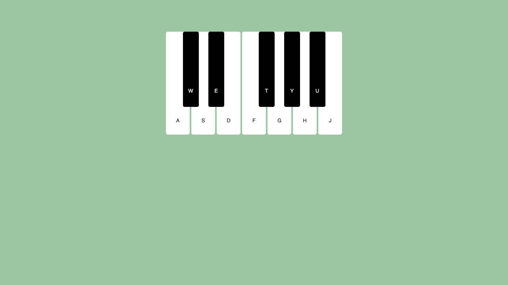
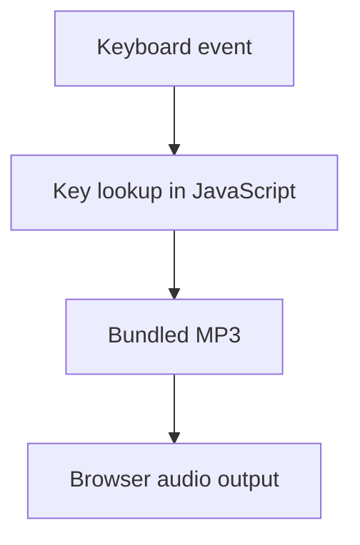

# Virtual Piano

A browser piano built for learning HTML, CSS and JavaScript. It maps 12 computer keyboard keys to bundled MP3 notes.

[Demo](#demo) · [Repository map](#repository-map) · [PDF slides](docs/readme/overview.pdf) · [AGENTS.md](AGENTS.md)

## Demo



The local piano interface. A keyboard test verified the A-to-A.mp3 mapping and the bundled file.

1. Open the piano in a browser and focus the page.
2. Press A, S and D to request different notes.
3. Try W or E for a black key.

## How it works



## Repository map

| File or directory | Purpose |
| --- | --- |
| [`Virtual Piano/task/src/index.html`](Virtual%20Piano/task/src/index.html) | Piano markup |
| [`Virtual Piano/task/src/style.css`](Virtual%20Piano/task/src/style.css) | White and black key layout |
| [`Virtual Piano/task/src/keyPress.js`](Virtual%20Piano/task/src/keyPress.js) | Keyboard events and audio lookup |
| [`Virtual Piano/task/src/white_keys`](Virtual%20Piano/task/src/white_keys) | MP3 samples for all 12 mapped keys |

## Quick start

```sh
python3 -m http.server 8000 --bind 127.0.0.1 --directory 'Virtual Piano/task/src'
```

Open `http://127.0.0.1:8000/`. A browser may require an initial interaction before playing audio.

| Keys | Keyboard input |
| --- | --- |
| White | A S D F G H J |
| Black | W E T Y U |

Check the script with `node --check 'Virtual Piano/task/src/keyPress.js'`.
